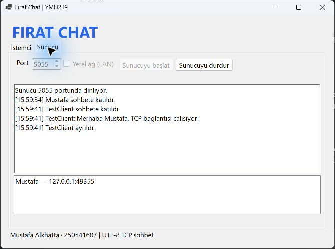

# Fırat Chat — YMH219

TCP/IP üzerinden kullanıcı adıyla bağlanan istemciler arasında zaman damgalı mesajlaşma sağlayan Windows Forms uygulaması. Sunucu ve istemci sekmeleri aynı programda bulunur; farklı program örnekleri birbiriyle konuşabilir.

**Öğrenci:** Mustafa Alkhatta — **250541607**

## Teknolojiler
C#, .NET 10, Windows Forms, TcpListener, TcpClient, StreamReader/StreamWriter, async/await. Harici NuGet paketi yoktur.

## Kurulum ve çalıştırma
Windows 10/11, .NET 10 SDK veya .NET masaüstü iş yükü kurulu Visual Studio gerekir.

```powershell
git clone https://github.com/MustafaAlkhattab/YMH219-ChatApp.git
cd YMH219-ChatApp
dotnet build -c Release
dotnet run -c Release
```

1. İlk pencerede **Sunucu** sekmesini açın. Port 5055 kalsın ve **Sunucuyu başlat** düğmesine basın.
2. Aynı programı ikinci kez açın. **İstemci** sekmesinde adres `127.0.0.1`, port `5055` ve kullanıcı adınızı girip **Bağlan** deyin.
3. Bir üçüncü program örneğini farklı kullanıcı adıyla bağlayabilirsiniz. Mesajı yazıp **Gönder** veya Enter kullanın; mesaj bağlı tüm istemcilere iletilir.
4. **Bağlantıyı kes** istemciyi, **Sunucuyu durdur** tüm oturumu kapatır. Bir program içinde iki sekmeyi kullanarak da yerel deneme yapılabilir.
5. LAN denemesinde sunucuda **Yerel ağ (LAN)** seçilir, istemcide sunucu bilgisayarın yerel IP adresi kullanılır. Ağ/firewall erişimi ortama bağlıdır; uygulama sistem ayarını değiştirmez.

## Özellikler ve sınıf tasarımı
- `ChatServer`: bağlantı kabul etme, isim alma, istemci listesi, çoklu istemciye yayın ve kapatma.
- `ChatClient`: zaman aşımı olan bağlantı, satır tabanlı UTF-8 iletişim ve asenkron alma.
- `Form1`: bağlantı durumları, mesaj listeleri ve hata bildirimi. Arka plan olayları BeginInvoke ile arayüz iş parçacığına taşınır.
- Sunucu listesinde ad ve uzak uç nokta gösterilir. Mesajların sunucu saatiyle zamanı eklenir.
- Her istemcinin yazma kilidi eşzamanlı yayınların satırlarını korur. Boş girişler reddedilir; kullanıcı adı 30, mesaj 2000 karakterle sınırlıdır.

## Ekran görüntüleri



## Kontrol ve sınırlamalar
- Release derlemesi: 0 hata, 0 uyarı.
- Yerel sunucu başlatma, Mustafa istemcisinin bağlanması, ayrı TCP test istemcisinin mesajının arayüze gelmesi ve ayrılma bildirimi doğrulandı.
- Farklı bilgisayarda/LAN üzerinde test henüz yapılmadı.
- Ders amaçlı yerel protokoldür; şifreleme, hesap doğrulama ve kalıcı mesaj geçmişi yoktur. Satırlar mesaj sınırıdır; kullanıcı arayüzü tek satır mesaj gönderir.

## Sözlü hazırlık
TCP bir bayt akışıdır; ReadLine/WriteLine mesaj sınırlarını yeni satırla belirler. await bağlantı beklenirken arayüzün çalışmasını sağlar. Socket kapanınca alma döngüsü biter ve durum güncellenir.

## Kaynak
[Microsoft TcpListener.AcceptTcpClientAsync](https://learn.microsoft.com/en-us/dotnet/api/system.net.sockets.tcplistener.accepttcpclientasync?view=net-10.0)
