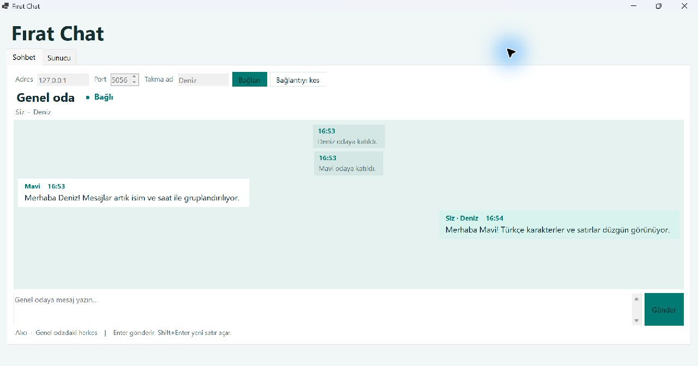

# Fırat Chat

YMH219 için C# / Windows Forms istemci ve sunucu uygulaması. Birden fazla kullanıcı takma adlarıyla aynı TCP odasında mesajlaşabilir.

**Öğrenci** · Mustafa Alkhatta, 250541607

## Çalıştırma

Windows 10/11 ve .NET 10 SDK gerekir. Visual Studio'da `ChatApp.csproj` açıp F5'e basabilirsiniz.

```powershell
git clone https://github.com/MustafaAlkhattab/YMH219-ChatApp.git
cd YMH219-ChatApp
dotnet run -c Release
```

1. **Sunucu** sekmesinde dinleme portunu seçin (varsayılan `5056`) ve **Sunucuyu başlat** düğmesine basın.
2. Aynı pencerede **Sohbet** sekmesine geçebilir veya ikinci bir pencere açabilirsiniz. Adres `127.0.0.1`, port sunucuyla aynı olmalı. Bir takma ad girip **Bağlan** deyin.
3. Başka bir pencereden farklı bir takma adla aynı odaya katılın. **Gönder** veya Enter mesajı genel odaya yollar. Shift+Enter yeni satır açar.
4. Kendi mesajınız sağdaki renkli balonda **Siz · Takma ad**, diğer mesajlar solda gönderen ve saat ile görünür. Ortadaki satırlar sistem bildirimleridir.
5. Sunucu sekmesinde bağlı adlar, uç noktalar ve giriş saati görünür. Oturumlar **Bağlantıyı kes** veya **Sunucuyu durdur** ile kapatılır.
6. Yerel ağdaki başka bir bilgisayar için **Yerel ağ (LAN)** seçilir ve istemciye sunucunun yerel IP adresi yazılır.

## Teknoloji ve tasarım

C# / .NET 10, Windows Forms, `TcpListener`, `TcpClient`, `NetworkStream`, JSON ve async/await. Ek NuGet paketi yoktur. `RoomHost` katılımcılara sunucu kimliği atar, aynı adı reddeder, olayları yayımlar ve listeyi tutar. `RoomProtocol` her JSON mesajını bir uzunluk başlığıyla çerçeveler. `Conversation` gönderen kimliğine göre kendi ve gelen mesajları ayırır ve pencere genişliğine göre metni sarar.

## Ekran görüntüleri




## Doğrulama ve sınırlamalar

İki istemcinin Unicode ve çok satırlı mesaj alışverişi, kullanıcı adının benzersizliği, sunucunun kapanması ve Windows Release derlemesi doğrulandı. Bu, güvenilen yerel ağda ders amaçlı genel odadır. Geçmiş bellekte tutulur ve içerik şifrelenmez. Sürüm güncellendiğinde iki uçta da aynı sürümü kullanın. Farklı fiziksel bilgisayarlar arasında LAN bağlantısı ayrıca denenebilir.
